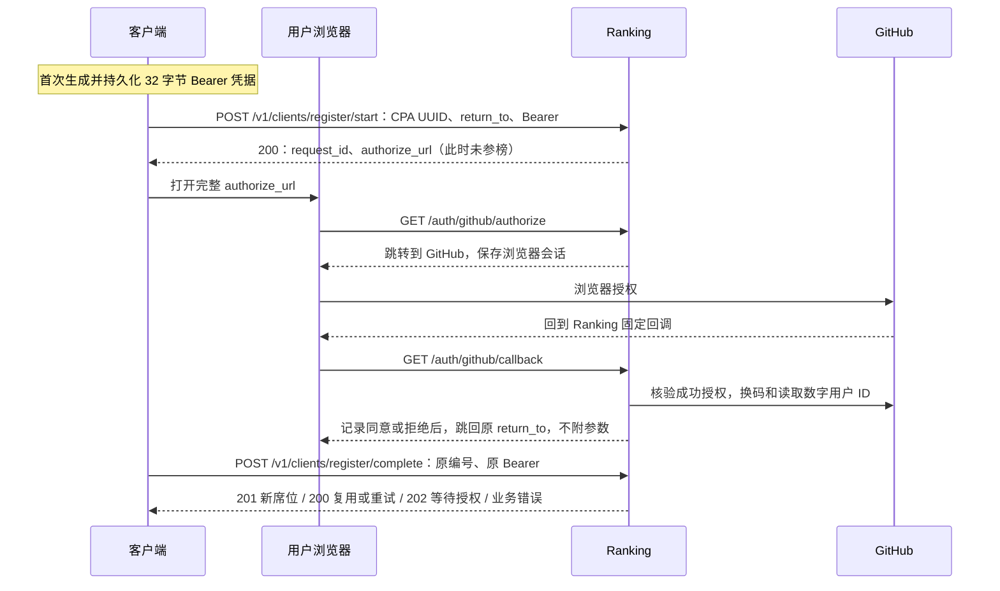
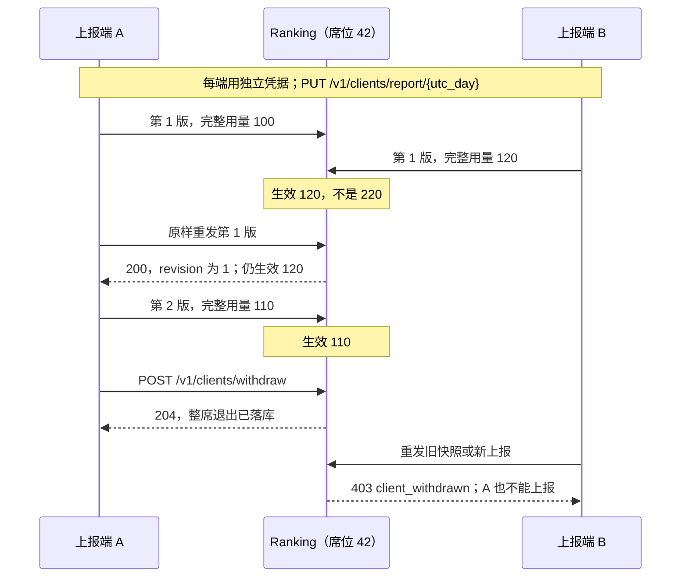

# 接入流程与时序

参榜客户端提供完整日用量；只展示榜单的客户端直接匿名调用 `GET /v1/leaderboards/{board}/{period}`（无查询参数）。下列客户端本地状态由接入方负责，完整字段和错误码见[接入指南](integration.md)。

## 注册：客户端办结与浏览器回跳分开

`202` 按 `Retry-After` 使用原编号重试。办结回复丢失时，未到期用原编号和原密钥重试；过期则保留原密钥重新领号，用相同 GitHub 帐号、相同 CPA UUID 授权再办结。已退出或被禁用的席位不会恢复。授权拒绝后不应自动再次发起授权。

## 上报：不同 writer、同一席位

上报端应先保存待发的日期、修订号与完整正文，再发送。收到 `200` 时核对回执中的 `revision` 是否是**本次请求**的值。响应超时或丢失不代表事务未提交；保留原任务有界退避并重试。`409` 返回本端当前版本，先核对状态，不盲目加号覆盖。`410 expired_day` 后不要改日期重报。`429` 或 `503 report_overloaded` 需遵守 `Retry-After`。上报窗口只接受 UTC 今天或昨天。

## 榜单缓存与成功判定

| 阶段 | 完成标志 | 不代表什么 |
|---|---|---|
| 领号 | 收到 `request_id` 和授权链接 | 没有上报权限 |
| 注册 | 收到 `201` 或 `200` | 未提交用量 |
| 日快照确认 | 收到 `200` 且回执修订号匹配本次请求 | 未保证入榜或已刷新 |
| 退出 | 收到 `204` | 旧榜单缓存不一定已替换 |
| 读榜 | `200` 返回 `entries`、实际边界、`generated_at` | 空榜是正常响应；可能保留上次成功轮次 |

后台基于已提交的资料和统计构建五个榜单、六个 UTC 周期；完整轮次成功后才原子发布。退出请求触发刷新，普通写入不触发；默认定时为 5 分钟，不承诺固定可见时间。`503 leaderboard_unavailable` 不是空榜。`week` / `month` 是上一完整 UTC 自然周 / 月；月首或周一时昨天仍可上报。`/healthz`、`/readyz` 供独立运维检查，不是接入步骤。
