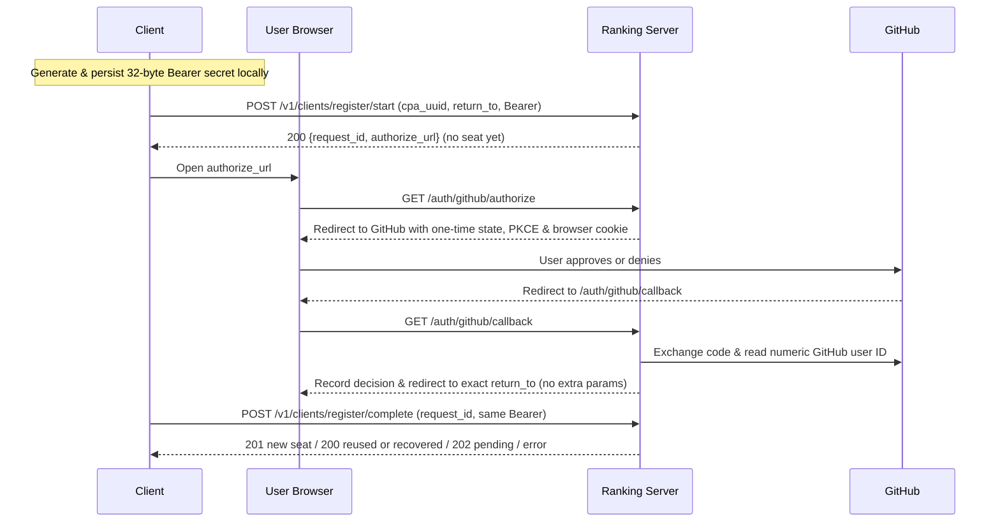

# Client Integration Guide

[简体中文](integration.zh.md) · [README](../README.md)

This guide defines the public HTTP JSON protocol for any usage collector, gateway, or dashboard that reports usage snapshots or displays leaderboards. Clients read and aggregate local data independently; the server requires no client SDK, specific database, or upstream event schema.

## Endpoints Overview

All paths are relative to the deployment's HTTPS origin (for example `https://ranking.example.com`).

| Method | Path | Auth | Purpose |
| --- | --- | --- | --- |
| `POST` | `/v1/clients/register/start` | Writer `Bearer <secret>` | Submit CPA UUID and `return_to`; receive `request_id` and `authorize_url` |
| `POST` | `/v1/clients/register/complete` | Same `Bearer <secret>` | Complete registration after GitHub authorization |
| `POST` | `/v1/clients/withdraw` | Registered `Bearer <secret>` | Withdraw the entire seat (empty body, no query parameters) |
| `PUT` | `/v1/clients/report/{utc_day}` | Registered `Bearer <secret>` | Atomically replace the seat's full cumulative snapshot for one UTC day |
| `GET` | `/v1/leaderboards/{board}/{period}` | None | Fetch the latest published Top-100 leaderboard cache |
| `GET` / `HEAD` | `/avatars/catalog.json` | None | Fetch the avatar catalog, default ID, and relative asset paths |
| `GET` / `HEAD` | `/avatars/{path}` | None | Fetch an avatar WebP binary (`HEAD` returns headers only) |
| `GET` | `/healthz` | None | Liveness probe (`200 {"status":"ok"}`) |
| `GET` | `/readyz` | None | Readiness probe (`200 {"status":"ready"}` after DB, catalogs, and first cache build) |

Browsers also traverse `/auth/github/authorize` and `/auth/github/callback` during OAuth authorization; these are browser redirect routes rather than JSON client APIs.

**Transport and privacy requirements:**
- Always use **HTTPS** in production. HTTP on loopback is only for local development or behind a trusted TLS-terminating reverse proxy.
- Send uncompressed UTF-8 JSON with `Content-Type: application/json` (`charset` parameter is accepted; no `Content-Encoding` other than `identity`).
- Never place Bearer secrets in URLs, request bodies, logs, public pages, or source repositories. Never upload upstream model API keys, prompts, or response payloads.
- Clients that only display leaderboards need no registration or credentials.

## Credentials, Registration, and Withdrawal

### Client-Owned Credentials

Before the first registration attempt, each reporting installation generates **32 bytes from a cryptographically secure random source**, encodes them as **43-character unpadded `base64url`** (RFC 4648 URL alphabet `A–Z a–z 0–9 - _`, no `=` or whitespace), and persists the secret durably in protected storage.

- Send exactly one `Authorization: Bearer <secret>` header (scheme is case-insensitive, separated by one space).
- The server decodes the 43-character token and stores only the **32-byte `SHA-256` digest of the decoded bytes**—never the raw secret.
- Each reporting installation uses its own credential; multiple writers for the same seat must not share a secret.
- The server does not generate secrets, rotate credentials, issue sessions, or recover lost secrets. Keeping only `client_id` is insufficient for reporting or retries.

### GitHub OAuth Registration Flow



#### Step 1: Start Registration

```http
POST /v1/clients/register/start
Authorization: Bearer <secret>
Content-Type: application/json

{"cpa_uuid":"550e8400-e29b-41d4-a716-446655440000","return_to":"http://localhost:8080/settings?tab=ranking#status"}
```

- `cpa_uuid`: Persistent, nonzero `8-4-4-4-12` hex UUID supplied by the CPA instance (case-insensitive). Do not invent an independent UUID per collector if multiple collectors report for the same CPA instance.
- `return_to`: Absolute `http` or `https` URL without userinfo (`localhost`, LAN IPs, public IPs, and DNS names are all allowed; ports, paths, query strings, and fragments are preserved). Never put secrets in `return_to`.
- `200 OK` returns `{"request_id":"...","authorize_url":"https://ranking.example.com/auth/github/authorize?request_id=..."}`. Save `request_id` (default lifetime: 10 minutes) and open `authorize_url` unchanged in the user's browser. This step grants no write permission.

#### Step 2: Browser Authorization

The server binds the browser flow with a `Secure; HttpOnly; SameSite=Lax` cookie, one-time state, and `S256` PKCE, exchanges the authorization code server-side, and reads the authenticated GitHub user without requesting repository or email scopes or storing any GitHub token. After recording approval or denial, the server redirects to the exact saved `return_to` with no added query parameters and sets `Referrer-Policy: no-referrer`. Ranking never makes a server-side HTTP request to `return_to`, and a browser return is **not** proof of registration.

#### Step 3: Complete Registration

```http
POST /v1/clients/register/complete
Authorization: Bearer <same-secret-as-start>
Content-Type: application/json

{"request_id":"<original-request-id>"}
```

- `202 Accepted` with `Retry-After` (seconds, empty body): waiting for browser authorization; retry with the same `request_id` and Bearer secret after that delay.
- `201 Created`: new ranking seat created.
- `200 OK`: existing seat reused or committed completion recovered.

Success response (`client_id` and `avatar_id` are positive int64 decimal strings):

```json
{"client_id":"42","display_name":"Alice","avatar_id":"1"}
```

**Seat identity and profile rules:**
- A seat is uniquely identified by **`(GitHub numeric user ID, CPA UUID)`**. Additional writers for the same pair share the seat without changing its profile. A credential can never be rebound to a different seat.
- New seats take their initial `display_name` from GitHub `name`, falling back to GitHub `login` (truncated to fit), and receive the catalog's default avatar (no GitHub avatar sync or profile-edit API).
- **Display-name normalization** (applied automatically to GitHub `name`/`login`): requires valid UTF-8, applies Unicode **NFKC** normalization, rejects Unicode control characters (`Cc`), line/paragraph separators (`Zl`/`Zp`), and `Bidi_Control` before trimming, trims outer Unicode whitespace, enforces **1–32 Unicode code points and ≤128 UTF-8 bytes**, and requires visible content (not solely whitespace, combining marks, format characters, default-ignorables, or Braille blank `U+2800`). Duplicate names are allowed; render display names as escaped plain text.
- **Lost-response recovery**: If a `start` response is lost, call `start` again with the same secret. If a `complete` response is lost or times out, retry `complete` with the same `request_id` and secret before expiry. After expiry, keep the **same secret** and run `start` → authorize → `complete` again with the same GitHub account and CPA UUID; if the earlier write succeeded, completion reuses that seat and writer. Disabled or withdrawn seats cannot be restored by retrying or re-authorizing.

### Withdraw an Entire Seat

```http
POST /v1/clients/withdraw
Authorization: Bearer <registered-writer-secret>
```

Send no request body or query parameters. `204 No Content` confirms the seat is marked withdrawn in SQLite (idempotent if repeated by any writer of that seat). Withdrawal preserves historical records and administrator flags, immediately blocks **every writer** on that seat from reporting or retrying (`403 client_withdrawn`), and removes the seat from all leaderboards and scoring references on the next successful cache build. Other seats (for example a different CPA UUID under the same GitHub account) are unaffected. There is no public rejoin API.

## Daily Cumulative Snapshot Reporting

```mermaid
sequenceDiagram
    participant A as Writer A
    participant R as Ranking Server (Seat 42)
    participant B as Writer B
    Note over A,B: Independent Bearer secrets; PUT /v1/clients/report/{utc_day}
    A->>R: revision "1", full total 100
    B->>R: revision "1", full total 120
    Note over R: Seat/day active snapshot = 120 (last replacement wins, never summed)
    A->>R: Retry exact revision "1" (total 100)
    R-->>A: 200 {"revision":"1"} (confirmed without overwriting 120)
    A->>R: revision "2", full total 110
    Note over R: Seat/day active snapshot = 110
    A->>R: POST /v1/clients/withdraw
    R-->>A: 204 (entire seat withdrawn)
    B->>R: Retry or new report
    R-->>B: 403 client_withdrawn (all writers stop)
```

### Reporting Window and Aggregation Rules

- `{utc_day}` must be `YYYY-MM-DD` in **UTC** (never local timezone) and within the open window: **UTC today or UTC yesterday**. Future dates return `422 invalid_day`; closed older dates return `410 expired_day`.
- Every `PUT` sends the **complete cumulative snapshot** for that seat and UTC day—not per-request events or incremental deltas. After a client restarts, it must reconstruct the full day's totals before reporting.
- Merge all local sources for the same canonical model into **one item per model** (no `service_tier` field is accepted, not even `"default"` or `null`). Duplicate normalized model names or aliases resolving to the same canonical model reject the entire snapshot.
- Compute `ttft_avg_ms` and `latency_avg_ms` from summed durations divided by their own sample counts (sample-weighted when merging groups; never average group averages equally). When no latency sample exists, send `null` with `"0"` samples—never fabricate zero latency.
- Model names are stripped through the final `/` and matched **exact, case-sensitive** against the server's [model catalog](catalogs.md#model-catalog). Valid unmatched models are skipped from totals without error and are not returned in the response; any malformed item (even an unknown model) rejects the whole snapshot.

### Request Schema and Validation

```http
PUT /v1/clients/report/{utc_day}
Authorization: Bearer <secret>
Content-Type: application/json
```

```json
{
  "schema_version": 1,
  "revision": "1",
  "items": [
    {
      "model": "claude-opus-4-5",
      "total_tokens": "150000",
      "input_tokens": "100000",
      "output_tokens": "50000",
      "cache_read_tokens": "60000",
      "cache_write_tokens": "0",
      "reasoning_tokens": "10000",
      "request_count": "42",
      "success_count": "41",
      "ttft_avg_ms": 320.5,
      "ttft_samples": "41",
      "latency_avg_ms": 1850.0,
      "latency_samples": "41"
    }
  ]
}
```

Every field below is required (even when `0` or `null`). Unknown fields, duplicate JSON keys, invalid UTF-8, unpaired surrogates, and trailing JSON values are rejected.

| Field | Scope | JSON Type | Constraints |
| --- | --- | --- | --- |
| `schema_version` | Root | Integer | Must be `1` |
| `revision` | Root | Decimal string | Writer-scoped monotonic int64 (`0` to `9223372036854775807`) |
| `items` | Root | Array | Complete day snapshot; `[]` clears matched totals while advancing revision |
| `model` | Item | String | Nonempty UTF-8 ≤128 bytes, no control chars, nonempty final path segment |
| `total_tokens` | Item | Decimal string | `>= input_tokens + output_tokens` (may include unclassified remainder) |
| `input_tokens`, `output_tokens` | Item | Decimal string | Nonnegative int64 |
| `cache_read_tokens`, `cache_write_tokens` | Item | Decimal string | `cache_read_tokens + cache_write_tokens <= input_tokens` |
| `reasoning_tokens` | Item | Decimal string | `reasoning_tokens <= output_tokens` |
| `request_count`, `success_count` | Item | Decimal string | `success_count <= request_count`; nonzero usage requires `request_count > 0` |
| `ttft_avg_ms`, `latency_avg_ms` | Item | Number or `null` | Finite and `>= 0` when samples `> 0`; must be `null` when samples `== "0"` |
| `ttft_samples`, `latency_samples` | Item | Decimal string | Each `<= request_count` |

Decimal strings must contain nonnegative int64 digits without `+` signs (avoid leading zeros). Integer or floating-point aggregation overflow rejects the snapshot.

### Revisions, Idempotency, and Conflicts

`revision` is a **per-writer, per-UTC-day** snapshot counter (starting at `"0"` or `"1"`, gaps allowed; next day can restart from `"0"` or `"1"`). It is not a software version.

| Submission Case | Server Result |
| --- | --- |
| First submission or higher `revision` for this writer/day | Atomically replaces the seat's active day snapshot; returns `200 {"revision":"<n>"}` |
| Same `revision` and identical order-independent content digest | Idempotent `200 {"revision":"<n>"}` without rewriting active data or rematching the model catalog |
| Lower `revision`, or same `revision` with different content | `409 revision_conflict` returning the writer's current decimal-string `revision` |

**Client reliability rules:**
- Persist the pending `{utc_day, revision, payload}` locally before sending. Confirm success only when HTTP is `200` **and** the returned `revision` equals the exact revision sent in that request.
- On timeout, dropped connection, or unreadable response, keep the exact same `revision` and payload and retry with bounded backoff.
- A higher revision may decrease metrics or omit models; `items: []` clears matched totals for that day. Never send `items: []` to represent a temporary local collection failure, and never split one day across multiple incremental `PUT`s.
- On `409 revision_conflict`, inspect the returned `revision` and check for concurrent local writers—do not blindly bump `revision` over unknown state unless you can reconstruct the authoritative complete snapshot for that day.

## Minimal End-to-End cURL Example

Run against a deployment with [GitHub OAuth configured](deployment.md#github-oauth-app):

```sh
# 1. Generate and persist a 43-char unpadded base64url secret (32 random bytes)
SECRET=$(openssl rand -base64 32 | tr '+/' '-_' | tr -d '=\n')
BASE=https://ranking.example.com

# 2. Start registration; save request_id and open authorize_url in a browser
curl -sS -X POST "$BASE/v1/clients/register/start" \
  -H "Authorization: Bearer $SECRET" -H 'Content-Type: application/json' \
  -d '{"cpa_uuid":"550e8400-e29b-41d4-a716-446655440000","return_to":"http://localhost:3001/settings?tab=ranking#status"}'

# 3. After approving in GitHub, complete with the same request_id and secret
REQUEST_ID='replace-with-returned-request-id'
curl -sS -X POST "$BASE/v1/clients/register/complete" \
  -H "Authorization: Bearer $SECRET" -H 'Content-Type: application/json' \
  -d "{\"request_id\":\"$REQUEST_ID\"}"

# 4. After 200 or 201, upload the full cumulative snapshot for the UTC day
TODAY=$(date -u +%F)
curl -sS -X PUT "$BASE/v1/clients/report/$TODAY" \
  -H "Authorization: Bearer $SECRET" -H 'Content-Type: application/json' \
  -d '{
    "schema_version": 1,
    "revision": "1",
    "items": [{
      "model": "claude-opus-4-5",
      "total_tokens": "150000",
      "input_tokens": "100000",
      "output_tokens": "50000",
      "cache_read_tokens": "60000",
      "cache_write_tokens": "0",
      "reasoning_tokens": "10000",
      "request_count": "42",
      "success_count": "41",
      "ttft_avg_ms": 320.5,
      "ttft_samples": "41",
      "latency_avg_ms": 1850.0,
      "latency_samples": "41"
    }]
  }'

# 5. Read the public Overall leaderboard (no credential required)
curl -sS "$BASE/v1/leaderboards/overall/today"
```

## Public Leaderboards and Avatars

### Reading Leaderboards

```http
GET /v1/leaderboards/{board}/{period}
```

- `board`: `overall`, `usage`, `cache`, `success`, `ttft`
- `period`: `today`, `yesterday`, `week` (previous complete UTC Monday–Monday week), `month` (previous complete UTC calendar month), `year` (current UTC year), `all` (all-time)
- No query parameters are accepted (no pagination, model filters, or cache-busting timestamps).
- `client_id`, `avatar_id`, and `metric` are decimal strings (`usage` is an integer; other metrics have two decimal places); `rank` is an integer with competition ranking (`1, 1, 3`). Only `overall` entries include a `details` object (`total_tokens`, `request_count`, `success_rate`, `cache_read_rate`, `ttft_mean_ms`, `latency_mean_ms`).
- Full response examples, scoring formulas, and UI formatting rules are documented in [Leaderboards & Scoring](leaderboards.md).

### Fetching Avatars

- `GET /avatars/catalog.json` returns `{"default_avatar_id": 1, "avatars": [{"avatar_id": 1, "path": "images/001.webp"}, ...]}` (`avatar_id` is a JSON integer here, whereas registration/leaderboard responses encode it as a decimal string).
- Resolve each `path` relative to `/avatars/` (for example `/avatars/images/001.webp`) and request with `GET` (`Content-Type: image/webp`, binary WebP) or `HEAD`. Do not guess image paths from IDs. Both catalog and image endpoints support `ETag` conditional requests (`304 Not Modified`). See [Catalogs & Brand Assets](catalogs.md#avatar-catalog).

### Completion Signals vs. Non-Guarantees

| Stage | Confirmed By | Does **Not** Imply |
| --- | --- | --- |
| Start registration | `200` with `request_id` and `authorize_url` | Seat created or write access granted |
| Complete registration | `201` or `200` | Usage uploaded |
| Daily report | `200` with matching `revision` | Immediate appearance in leaderboard cache |
| Withdraw | `204` | Old leaderboard cache already replaced |
| Read leaderboard | `200` with `entries`, `start`/`end`, `generated_at` | Non-empty entries or guaranteed cache freshness |

Ordinary reports do not trigger immediate cache rebuilds (default refresh interval is 5 minutes; withdrawals trigger an asynchronous rebuild). Display `generated_at` when polling and never use the leaderboard API to confirm a report write.

## Error Contract, Retries, and Limits

API errors use the JSON structure below. Branch on HTTP status and `error.code`, not on `message`. Reverse proxies may return non-JSON errors; never treat them as write confirmations.

```json
{"error":{"code":"report_rate_limited","message":"Report admission limit reached"}}
```

| Status | `error.code` | Client Action |
| --- | --- | --- |
| `202` | — (`Retry-After` header) | Registration pending browser approval; retry `complete` with same `request_id` and Bearer |
| `400` / `422` | `invalid_request`, `invalid_source`, `invalid_parameter`, `invalid_day`, `invalid_report`, `too_many_items` | Fix request payload or path; do not retry unchanged |
| `401` | `invalid_credential` (`WWW-Authenticate: Bearer`) | Verify origin, Bearer secret, and registration state; do not auto-generate a new secret |
| `403` | `github_authorization_denied` | User denied authorization; stop and do not auto-restart OAuth |
| `403` | `client_disabled` | Seat banned by admin; stop reporting and contact the operator |
| `403` | `client_withdrawn` | Seat withdrawn; stop all registration retries and reporting on every writer |
| `404` / `405` | `not_found`, `method_not_allowed` | Verify endpoint URL and HTTP method |
| `409` | `revision_conflict` (includes current `revision`) | Reconcile local state and concurrent writers before revising |
| `410` | `registration_request_expired` | Keep the original secret and start a new registration if still desired |
| `410` | `expired_day` | Stop retrying that UTC day; never move its data into another date |
| `413` | `request_too_large` | Reduce payload size; never split one day into incremental `PUT`s |
| `415` | `unsupported_media_type` | Send uncompressed `application/json` |
| `429` | `registration_rate_limited`, `registration_capacity`, `report_rate_limited`, `report_capacity` | Wait at least `Retry-After` seconds plus random jitter before retrying |
| `503` | `report_overloaded` | Keep original `revision` and payload; obey `Retry-After` with exponential backoff |
| `503` | `registration_closed` | Pause new registrations; existing writers and unexpired recovery retries continue |
| `503` | `leaderboard_unavailable` | First cache round not ready yet; retry later without displaying a fake empty board |
| `500` / network error | `internal_error` | Bounded exponential backoff with jitter; preserve secret (registration) or `revision` + payload (report) |

### Default Limits and Boundaries

Deployers can tune these defaults via [environment variables](deployment.md#configuration-reference); they are conservative defaults, not capacity guarantees:

| Limit | Default |
| --- | --- |
| Registration request body | `4,096` bytes |
| Registration start rate | `20`/source and `200` global per `1m` fixed window; max `10,000` active sources |
| Pending registration transactions | `10m` lifetime; max `2,000` unexpired transactions server-wide |
| Report body and items | `131,072` bytes; `128` raw items (before catalog matching) |
| Report rate per seat (shared by all writers) | `1` token per `1m`, burst `2` (retries consume budget) |
| Global report rate | `1` token per `5ms`, burst `400` |

**Explicit boundaries:**
- Serialize scheduling per writer and persist pending jobs across restarts.
- The server provides no credential recovery/rotation, profile edit, public rejoin, seat merge, single-client stats, submitted-snapshot query, closed-day backfill, per-model query, or built-in CORS layer (handle browser cross-origin policies at the reverse proxy, or report from a trusted backend/local process).
- `/healthz` and `/readyz` are operator probes, not part of client registration or reporting workflows.
