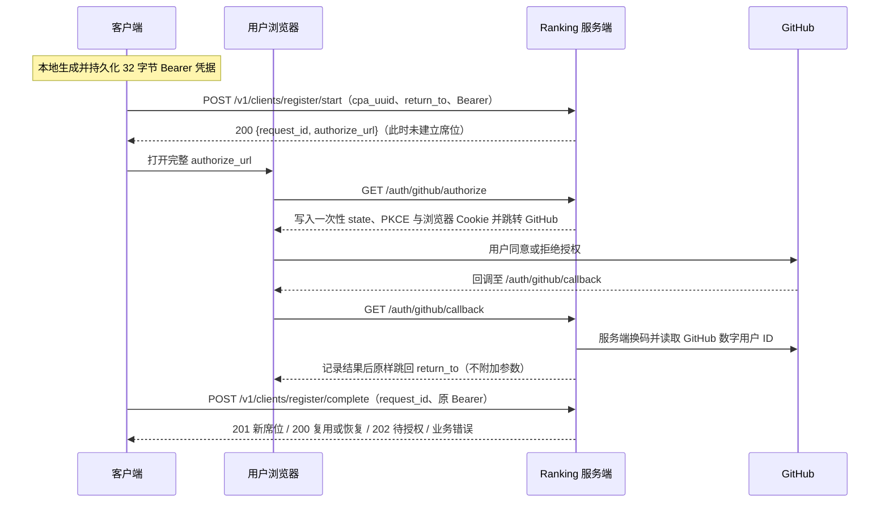
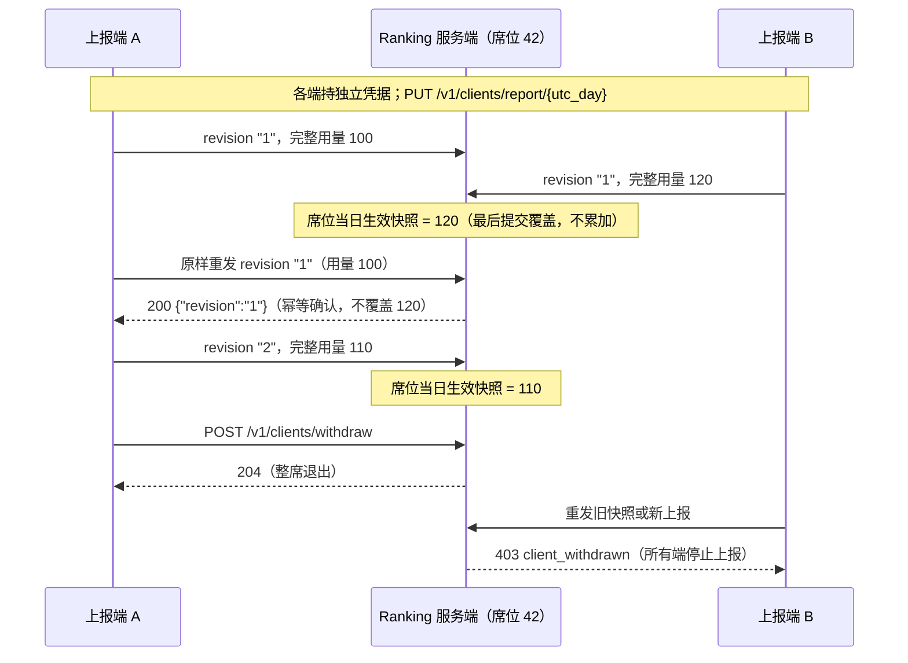

# 客户端接入指南

[English](integration.md) · [返回 README](../README.zh.md)

本文定义面向任意用量采集器、网关或面板的公开 HTTP JSON 协议。接入方自行读取并归并本地用量数据，服务端不依赖特定客户端 SDK、数据库结构或上游事件表。

## 接口总览

所有路径均相对于部署者的 HTTPS 入口（例如 `https://ranking.example.com`）。

| 方法 | 路径 | 鉴权 | 用途 |
| --- | --- | --- | --- |
| `POST` | `/v1/clients/register/start` | 本端 `Bearer <secret>` | 提交 CPA UUID 与 `return_to`，领取 `request_id` 和 `authorize_url` |
| `POST` | `/v1/clients/register/complete` | 领号时的同一 `Bearer` | GitHub 授权后完成注册 |
| `POST` | `/v1/clients/withdraw` | 已注册的 `Bearer` | 退出整个席位（空请求体、无查询参数） |
| `PUT` | `/v1/clients/report/{utc_day}` | 已注册的 `Bearer` | 原子替换该席位某个 UTC 日的完整累计快照 |
| `GET` | `/v1/leaderboards/{board}/{period}` | 无需 | 读取最新发布的公开缓存榜单（最多 100 名） |
| `GET` / `HEAD` | `/avatars/catalog.json` | 无需 | 获取头像清单、默认 ID 及相对图片路径 |
| `GET` / `HEAD` | `/avatars/{path}` | 无需 | 获取 WebP 头像二进制（`HEAD` 仅返回响应头） |
| `GET` | `/healthz` | 无需 | 存活探针（`200 {"status":"ok"}`） |
| `GET` | `/readyz` | 无需 | 就绪探针（数据库、目录及首轮榜单缓存完成后返回 `200 {"status":"ready"}`） |

浏览器在授权期间还会经由 `/auth/github/authorize` 与 `/auth/github/callback` 跳转，它们是浏览器重定向路由而非上报客户端 JSON API。

**传输与隐私要求：**
- 生产环境必须使用 **HTTPS**；回环 HTTP 仅用于本地调试或受信任的 TLS 反向代理之后。
- 请求正文使用未压缩的 UTF-8 JSON，设置 `Content-Type: application/json`（允许附带 `charset` 参数，不支持 gzip 等压缩编码）。
- 切勿在 URL、请求体、日志、公开页面或代码仓库中暴露 Bearer 凭据，也不要上传上游模型 API Key、提示词或响应正文。
- 仅展示排行榜的应用无需注册或持有凭据。

## 凭据、注册与退出

### 客户端自持凭据

首次注册前，每个上报端独立生成 **32 字节密码学安全随机数**，编码为 **43 字符无填充 `base64url`**（RFC 4648 URL 字符集 `A–Z a–z 0–9 - _`，不含 `=` 或空白），并先持久化到受保护的本地存储。

- 仅发送单个 `Authorization: Bearer <secret>` 请求头（scheme 不区分大小写，与凭据间以单个空格分隔）。
- 服务端将 43 字符编码解码回 32 字节后计算 **`SHA-256` 摘要**存储，不保存原文。
- 同一席位的多个上报端各自持有独立凭据，不得共享同一密钥。
- 服务端不签发、不轮换、不提供找回凭据或会话登录接口；仅保存 `client_id` 无法完成上报或重试。

### GitHub OAuth 注册流程



#### 第一步：领号（Start）

```http
POST /v1/clients/register/start
Authorization: Bearer <secret>
Content-Type: application/json

{"cpa_uuid":"550e8400-e29b-41d4-a716-446655440000","return_to":"http://localhost:8080/settings?tab=ranking#status"}
```

- `cpa_uuid`：由 CPA 实例提供的持久、非零 `8-4-4-4-12` 十六进制 UUID（不区分大小写）。同一 CPA 实例下的多个采集端须提交相同 UUID，不要各自随机生成。
- `return_to`：不含用户信息的绝对 `http` 或 `https` URL（支持 `localhost`、局域网 IP、公网 IP 及域名，保留端口、路径、查询串与锚点）。切勿在其中携带密钥。
- `200 OK` 返回 `{"request_id":"...","authorize_url":"https://ranking.example.com/auth/github/authorize?request_id=..."}`。保存 `request_id`（默认有效期 10 分钟），并在用户浏览器中原样打开 `authorize_url`。此步骤不创建席位也不授予写入权限。

#### 第二步：浏览器授权

服务端通过 `Secure; HttpOnly; SameSite=Lax` Cookie、一次性 state 和 `S256` PKCE 绑定浏览器会话，在服务端换取授权码并读取 GitHub 用户信息；不申请仓库或邮箱权限，也不持久化 GitHub Token。记录同意或拒绝后，服务端带 `Referrer-Policy: no-referrer` 跳转回原 `return_to`（不附加任何参数），且绝不会从服务端主动请求 `return_to`。浏览器回跳**不是**注册成功的确认凭证。

#### 第三步：办结（Complete）

```http
POST /v1/clients/register/complete
Authorization: Bearer <领号时的同一 secret>
Content-Type: application/json

{"request_id":"<原 request_id>"}
```

- `202 Accepted` 伴随 `Retry-After`（秒，空响应体）：等待用户授权，按提示延迟后使用原 `request_id` 和原 Bearer 重试。
- `201 Created`：创建了新的参榜席位。
- `200 OK`：复用了已有席位，或取回了此前已办结的结果。

成功响应（`client_id` 与 `avatar_id` 均为正 64 位整数的十进制字符串）：

```json
{"client_id":"42","display_name":"Alice","avatar_id":"1"}
```

**席位归属与资料规则：**
- 席位由 **`(GitHub 数字用户 ID, CPA UUID)`** 唯一确定。同一组合新增上报端时共用席位，不改动现有资料；同一凭据不可改绑到其他席位。
- 新席位默认采用 GitHub `name` 作为公开昵称，无效或为空时回退到 GitHub `login`（超长截断）；头像默认分配目录默认项（不同步 GitHub 头像，也无资料修改接口）。
- **昵称规范化规则**（服务端自动作用于 GitHub `name`/`login`）：校验合法 UTF-8 → 执行 Unicode **NFKC** 规范化 → 去空白前拒绝控制字符（`Cc`）、行/段分隔符（`Zl`/`Zp`）及 `Bidi_Control` → 去除首尾 Unicode 空白 → 要求 **1–32 个 Unicode 码点且 ≤128 UTF-8 字节** → 必须包含可见内容（不能仅由空白、组合标记、格式字符、默认可忽略字符或盲文空白 `U+2800` 组成）。允许重名，展示时须按纯文本转义渲染。
- **丢包恢复**：`start` 响应丢失时用原凭据重新领号即可；`complete` 超时或丢包时，未过期前用原 `request_id` 和原凭据重试；若已过期，保留**原凭据**重新执行 `start` → 授权 → `complete`（须使用同一 GitHub 账号与 CPA UUID），若此前已成功则会复用原席位与原上报端。已封禁或已退出的席位无法通过重试或重新授权恢复。

### 退出席位（Withdraw）

```http
POST /v1/clients/withdraw
Authorization: Bearer <已注册的 Bearer 凭据>
```

不传请求体或查询参数。返回 `204 No Content` 表示整席退出已落库（同一席位任意上报端重复调用均幂等返回 `204`）。退出保留历史统计与管理员标记，但会立即阻止该席位**所有上报端**继续上报或重试（返回 `403 client_withdrawn`），并在下一次成功发布榜单缓存后从全部榜单与评分参考样本中移除。同一 GitHub 账号下其他 CPA UUID 的席位不受影响。退出后不提供公开重新加入接口。

## UTC 日累计快照上报



### 上报窗口与聚合约定

- `{utc_day}` 须为 **UTC 时区**的 `YYYY-MM-DD`（非客户端本地日期），且仅允许 **UTC 今日或昨日**。未来日期返回 `422 invalid_day`，已封窗的历史日期返回 `410 expired_day`。
- 每次 `PUT` 必须提交该席位、该 UTC 日的**完整累计统计**，而非单条事件或本次增量。客户端重启后须恢复当日完整汇总后再上报。
- 须先按标准模型合并所有本地来源，每个标准模型只能出现一次（不再接受 `service_tier` 字段，即使传 `"default"` 或 `null` 也会返回 `422`）。指向同一标准模型的重复项或别名会导致整份快照被拒绝。
- `ttft_avg_ms` 与 `latency_avg_ms` 须按耗时总和除以各自真实样本数计算（合并分组时按样本加权，切勿对各组均值再求平均）；无样本时均值传 `null`、样本数传 `"0"`，切勿补零。
- 模型名去除最后一个 `/` 之前的前缀后，按**精确、区分大小写**匹配服务端的[模型目录](catalogs.zh.md#模型目录)。合法但未匹配的模型会被静默跳过、不计入总量，服务端不返回被忽略列表；任一项格式非法（含未知模型）均会拒绝整份快照。

### 请求结构与校验规则

```http
PUT /v1/clients/report/{utc_day}
Authorization: Bearer <secret>
Content-Type: application/json
```

```json
{
  "schema_version": 1,
  "revision": "1",
  "items": [
    {
      "model": "claude-opus-4-5",
      "total_tokens": "150000",
      "input_tokens": "100000",
      "output_tokens": "50000",
      "cache_read_tokens": "60000",
      "cache_write_tokens": "0",
      "reasoning_tokens": "10000",
      "request_count": "42",
      "success_count": "41",
      "ttft_avg_ms": 320.5,
      "ttft_samples": "41",
      "latency_avg_ms": 1850.0,
      "latency_samples": "41"
    }
  ]
}
```

下表所有字段均必填（即使值为 `0` 或 `null`）。未知字段、重复 JSON 键、非法 UTF-8、孤立代理码点或尾随多余 JSON 均会被拒绝。

| 字段 | 层级 | JSON 类型 | 约束说明 |
| --- | --- | --- | --- |
| `schema_version` | 顶层 | 整数 | 固定为 `1` |
| `revision` | 顶层 | 十进制字符串 | 本上报端当日单调递增的 int64（`0` 至 `9223372036854775807`） |
| `items` | 顶层 | 数组 | 完整日快照；空数组 `[]` 清空当日已匹配统计并推进修订号 |
| `model` | 明细项 | 字符串 | 非空合法 UTF-8，≤128 字节，无控制字符，去路径后非空 |
| `total_tokens` | 明细项 | 十进制字符串 | `>= input_tokens + output_tokens`（可包含未归类余量） |
| `input_tokens`、`output_tokens` | 明细项 | 十进制字符串 | 非负 int64 |
| `cache_read_tokens`、`cache_write_tokens` | 明细项 | 十进制字符串 | `cache_read_tokens + cache_write_tokens <= input_tokens` |
| `reasoning_tokens` | 明细项 | 十进制字符串 | `reasoning_tokens <= output_tokens` |
| `request_count`、`success_count` | 明细项 | 十进制字符串 | `success_count <= request_count`；非零用量必须有 `request_count > 0` |
| `ttft_avg_ms`、`latency_avg_ms` | 明细项 | 数字或 `null` | 有样本时有限且 `>= 0`；样本数为 `"0"` 时必须为 `null` |
| `ttft_samples`、`latency_samples` | 明细项 | 十进制字符串 | 各自 `<= request_count` |

十进制字符串不得带 `+` 号（建议不带前导零）。整数或浮点聚合溢出将拒绝整份快照。

### 修订号（`revision`）、幂等与冲突处理

`revision` 是**按上报端 + UTC 日**独立维护的数据修订号（可从 `"0"` 或 `"1"` 起步，允许跳号，次日可重新起始），并非软件版本号。

| 提交情形 | 服务端行为 |
| --- | --- |
| 本端该日首次提交或更高 `revision` | 原子替换整席当日生效快照，返回 `200 {"revision":"<n>"}` |
| 同 `revision` 且与顺序无关的内容摘要一致 | 幂等返回 `200 {"revision":"<n>"}`，不覆盖现有数据，也不重新匹配模型目录 |
| 更低 `revision`，或同 `revision` 但内容不同 | 返回 `409 revision_conflict` 及本端当前十进制字符串 `revision` |

**客户端可靠性约定：**
- 发送前先持久化待发的 `{utc_day, revision, payload}`；仅当 HTTP 为 `200` **且**响应中的 `revision` 与**本次请求发送的值相等**时才标记成功。
- 超时、连接中断或响应无法解析不代表写入失败：保留原 `revision` 与完整正文，有界退避重试。
- 更高修订号可以下调统计或删除模型项；`items: []` 会清空当日已匹配统计。**切勿用空数组表示临时采集失败，也不要拆成多次增量 `PUT`。**
- 收到 `409 revision_conflict` 时，先核对返回的 `revision` 与本地状态、排查是否存在并发写入，切勿在无法重建当日完整权威快照时盲目加号覆盖。

## 最小端到端 cURL 示例

针对已[配置 GitHub OAuth 的 HTTPS 服务](deployment.zh.md#github-oauth-app)：

```sh
# 1. 生成并妥善保存 43 字符无填充 base64url 凭据（32 字节随机数）
SECRET=$(openssl rand -base64 32 | tr '+/' '-_' | tr -d '=\n')
BASE=https://ranking.example.com

# 2. 领号；保存返回的 request_id，并在浏览器打开 authorize_url
curl -sS -X POST "$BASE/v1/clients/register/start" \
  -H "Authorization: Bearer $SECRET" -H 'Content-Type: application/json' \
  -d '{"cpa_uuid":"550e8400-e29b-41d4-a716-446655440000","return_to":"http://localhost:3001/settings?tab=ranking#status"}'

# 3. 在 GitHub 同意授权后，用同一 request_id 与凭据办结
REQUEST_ID='替换为返回的 request_id'
curl -sS -X POST "$BASE/v1/clients/register/complete" \
  -H "Authorization: Bearer $SECRET" -H 'Content-Type: application/json' \
  -d "{\"request_id\":\"$REQUEST_ID\"}"

# 4. 收到 200 或 201 后，上报当前 UTC 日的完整累计快照
TODAY=$(date -u +%F)
curl -sS -X PUT "$BASE/v1/clients/report/$TODAY" \
  -H "Authorization: Bearer $SECRET" -H 'Content-Type: application/json' \
  -d '{
    "schema_version": 1,
    "revision": "1",
    "items": [{
      "model": "claude-opus-4-5",
      "total_tokens": "150000",
      "input_tokens": "100000",
      "output_tokens": "50000",
      "cache_read_tokens": "60000",
      "cache_write_tokens": "0",
      "reasoning_tokens": "10000",
      "request_count": "42",
      "success_count": "41",
      "ttft_avg_ms": 320.5,
      "ttft_samples": "41",
      "latency_avg_ms": 1850.0,
      "latency_samples": "41"
    }]
  }'

# 5. 读取公开综合总榜（无需凭据）
curl -sS "$BASE/v1/leaderboards/overall/today"
```

## 读取公开榜单与头像

### 公开榜单接口

```http
GET /v1/leaderboards/{board}/{period}
```

- `board`：`overall`、`usage`、`cache`、`success`、`ttft`
- `period`：`today`、`yesterday`、`week`（上一完整 UTC 周一至周一）、`month`（上一完整 UTC 自然月）、`year`（当前 UTC 自然年）、`all`（累计）
- 不接受任何查询参数（无分页、无模型筛选、无防缓存时间戳）。
- `client_id`、`avatar_id`、`metric` 均为十进制字符串（用量为整数，其余保留两位小数）；`rank` 为 JSON 整数，采用竞争排名（`1, 1, 3`）。仅 `overall` 条目附带 `details` 对象（`total_tokens`、`request_count`、`success_rate`、`cache_read_rate`、`ttft_mean_ms`、`latency_mean_ms`）。
- 完整响应格式、五维评分公式与前端格式化规则见[榜单与评分规则](leaderboards.zh.md)。

### 头像清单与图片

- `GET /avatars/catalog.json` 返回 `{"default_avatar_id": 1, "avatars": [{"avatar_id": 1, "path": "images/001.webp"}, ...]}`（清单中 `avatar_id` 为 JSON 整数，注册与榜单响应中为十进制字符串）。
- 将 `path` 相对 `/avatars/` 解析（例如 `/avatars/images/001.webp`），通过 `GET` 获取 `image/webp` 二进制图片或 `HEAD` 检查响应头，切勿按 ID 自行拼接路径。清单和图片均支持 `ETag` 条件请求（`304 Not Modified`）。详见[模型、头像与品牌资源目录](catalogs.zh.md#头像目录)。

### 完成标志与非保证边界

| 阶段 | 完成标志 | **不代表**什么 |
| --- | --- | --- |
| 领号 | 收到 `200`（含 `request_id` 与 `authorize_url`） | 已建立席位或具备上报权限 |
| 办结注册 | 收到 `201` 或 `200` | 已提交用量 |
| 日快照确认 | 收到 `200` 且回执 `revision` 匹配本次请求 | 已立即入榜或缓存已刷新 |
| 退出席位 | 收到 `204` | 旧榜单缓存已立即替换 |
| 读取榜单 | `200` 返回 `entries`、`start`/`end`、`generated_at` | 必然非空或缓存绝对最新 |

普通上报不触发立即重建缓存（默认每 5 分钟定时构建一轮；退出席位会触发异步刷新）。轮询时应展示 `generated_at`，不要用榜单接口代替写入确认。

## 错误码、重试策略与默认限流

业务错误统一返回如下 JSON 结构。请按 HTTP 状态码与 `error.code` 分支处理，勿匹配 `message` 文本；反向代理可能返回非 JSON 错误，不能视作成功确认。

```json
{"error":{"code":"report_rate_limited","message":"Report admission limit reached"}}
```

| 状态码 | `error.code` | 客户端处理建议 |
| --- | --- | --- |
| `202` | —（含 `Retry-After` 头） | 等待浏览器授权；按间隔用原 `request_id` 与原 Bearer 重试 `complete` |
| `400` / `422` | `invalid_request`、`invalid_source`、`invalid_parameter`、`invalid_day`、`invalid_report`、`too_many_items` | 修正参数或正文，不要原样无限重试 |
| `401` | `invalid_credential`（含 `WWW-Authenticate: Bearer`） | 检查入口、凭据与注册状态，不要自动重生成新凭据 |
| `403` | `github_authorization_denied` | 用户拒绝授权，停止流程且不自动再次拉起授权 |
| `403` | `client_disabled` | 席位已被管理员封禁，停止上报并联系部署者 |
| `403` | `client_withdrawn` | 整席已退出，所有上报端停止注册重试与上报 |
| `404` / `405` | `not_found`、`method_not_allowed` | 检查路径与 HTTP 方法 |
| `409` | `revision_conflict`（附带当前 `revision`） | 核对本地持久化状态与并发写入后再修正 |
| `410` | `registration_request_expired` | 保留原凭据，如需继续参榜则重新领号并授权 |
| `410` | `expired_day` | 停止补报该日期，不得把数据挪到其他日期 |
| `413` | `request_too_large` | 精简正文体积，不得拆成增量 `PUT` |
| `415` | `unsupported_media_type` | 改用未压缩的 `application/json` |
| `429` | `registration_rate_limited`、`registration_capacity`、`report_rate_limited`、`report_capacity` | 至少等待 `Retry-After` 秒并叠加随机抖动后重试 |
| `503` | `report_overloaded` | 保留原 `revision` 与正文，遵守 `Retry-After` 指数退避重试 |
| `503` | `registration_closed` | 暂停新注册；不影响已有端上报，也不影响未过期交易的办结恢复 |
| `503` | `leaderboard_unavailable` | 首轮缓存尚未就绪，延迟重试，不要伪装为空榜 |
| `500` / 网络错误 | `internal_error` | 有界指数退避加抖动；注册保留原凭据，上报保留原 `revision` 与正文 |

### 默认限流与接口边界

以下为保守默认值，实际参数可由部署者通过[环境变量](deployment.zh.md#环境变量参考)调整，不构成容量保证：

| 限制项 | 默认值 |
| --- | --- |
| 注册请求体上限 | `4,096` 字节 |
| 领号请求额度 | 每来源 `20` 次、全局 `200` 次 / `1m` 固定窗口；最多保留 `10,000` 个活跃来源 |
| 注册事务状态 | `10m` 有效期；全站最多同时保留 `2,000` 笔未过期事务 |
| 上报正文与条目上限 | `131,072` 字节；`128` 条原始模型项（匹配目录前） |
| 单席位上报额度（同席各端共用） | 每 `1m` 补充 `1` 个令牌，突发 `2`（重试同样消耗额度） |
| 全局上报额度 | 每 `5ms` 补充 `1` 个令牌，突发 `400` |

**协议边界：**
- 每个上报端应串行调度请求并持久化待确认任务，避免进程重启丢失凭据、修订号或当日汇总。
- 当前不提供凭据找回/轮换、资料修改、恢复退出席位、席位合并、单客户端统计查询、已提交快照回查、过期日期修复、逐模型或分页查询接口；服务端未内建 CORS，如需浏览器跨域调用由部署者在反向代理层配置，更推荐由服务端或本地受信任进程上报。
- `/healthz` 与 `/readyz` 供独立运维监控使用，不属于客户端接入流程。
